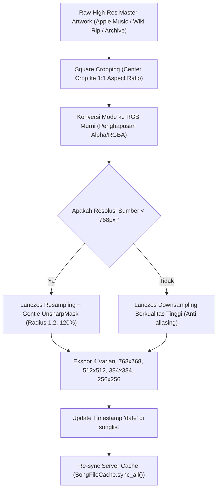

# Rencana & Dokumentasi Peningkatan Resolusi (HD Enhancement) Jacket Lagu Arcaea

Dokumen ini mencatat rencana kerja, standar teknis, dan pemetaan sumber (sources) resolusi tinggi untuk 18 lagu custom/server Arcaea.

---

## 1. Spesifikasi Teknis Jacket Arcaea (Asset Standard)

Setiap lagu dalam Arcaea membutuhkan 4 file jacket dengan format **JPEG RGB murni** (tidak boleh PNG atau memiliki alpha channel RGBA agar tidak memicu memory exception di client native C++):

1. `1080_base.jpg` — **768×768 px**, Quality 95 (Standar utama tampilan 1080p Arcaea).
2. `base.jpg` — **512×512 px**, Quality 92 (Fallback resolusi standar 720p).
3. `1080_base_256.jpg` — **384×384 px**, Quality 92 (Thumbnail carousel pemilihan lagu 1080p).
4. `base_256.jpg` — **256×256 px**, Quality 90 (Thumbnail carousel resolusi standar 720p).

---

## 2. Pipeline Pemrosesan Gambar (Enhancement Workflow)

---

## 3. Pemetaan Sumber Resolusi Tinggi (18 Lagu)

Seluruh 18 lagu telah diverifikasi dan diperbarui master jacket-nya dengan tautan langsung (direct link) / file master lokal berkualitas tinggi tanpa kompresi rusak:

| No | Song Query | Folder ID | Resolusi Master | Tipe Sumber | Detail Sumber / URL Terverifikasi | Catatan Revisi |
|:---:|---|---|:---:|:---:|---|---|
| 1 | **tsunagite** (系ぎて) | `tsunagite` | **1280×720** (Crop 720×720 / 1080p Video) | Direct URL / Video 1080p | Official SEGA maimai BUDDiES master `https://i.ytimg.com/vi/q26OmWO8ccg/maxresdefault.jpg` (atau frame video 1080p `https://www.youtube.com/watch?v=q26OmWO8ccg`) | **Diperbarui:** Menggantikan rip 500x500 lokal dengan master 1080p SEGA resmi. |
| 2 | **frozenette** | `frozenette` | **868×868** | Direct URL | SoundCloud Official Master (`https://i1.sndcdn.com/artworks-000549012198-9h856s-original.jpg`) | Asli dari komposer nitro. |
| 3 | **utakatanosekaide** (うたかたのせかいで) | `utakatanosekaide` | **642×642** (Master PNG) / **1920×1080** (SEGA PV) | File Master / Direct URL | `Chart/Kurumi087.utakatanosekaide.arcpkg` (`utakatanosekaide/base.jpg` 642x642 PNG murni by 煎茶) & `https://www.youtube.com/watch?v=NROQyBPX9Uo` | **Diperbarui:** Menggantikan cover album kompilasi CHUNITHM SUN dengan jacket asli lagu (Miim Miklar). |
| 4 | **666** | `triplesix` | **676×676** | Direct URL | SOUND VOLTEX Wiki MXM Official Rip (`https://static.wikia.nocookie.net/sound-voltex/images/9/95/666_MXM.png/revision/latest?cb=20230802120318`) | Asli SOUND VOLTEX V EXCEED GEAR. |
| 5 | **recollectlines** | `recollectlines` | **1400×1400** | Direct URL | Apple Music Official Master (`https://is1-ssl.mzstatic.com/image/thumb/Music211/v4/a6/db/b1/a6dbb1f5-11aa-afdb-8004-2ab63e3eabdf/0198448519892_cover.png/1400x1400bb.jpg`) | Asli ONGEKI bright MEMORY. |
| 6 | **blackswan** | `blackswan` | **1281×960** (Crop 960×960) | Chart Master | `Chart/blackswan/BLACKSWAN/black_swan.jpg` (Center Crop 960×960) | Asset asli artworker. |
| 7 | **avataar** | `avataar` | **2048×1080** (Crop 1080×1080) | Direct URL | Phigros Fandom Wiki Rip (`https://static.wikia.nocookie.net/phigros/images/1/15/Avataar_~Reincarnation_of_Kalpa~_jacket.png/revision/latest?cb=20250905140008`) | Asli Phigros × KALPA kolaborasi. |
| 8 | **abyssgazer** | `abyssgazer` | **512×512** (Lossless PNG) / **1920×1080** (PV 1:02) | Direct URL / Video 1080p | Paradigm: Reboot Wiki Direct Game Rip (`https://static.wikitide.net/paradigmrebootzhwiki/8/81/Cover_abyssgazer.png`) & Official PV `https://www.youtube.com/watch?v=XLRzISm_Y18` | **Diperbarui:** Menggantikan arcpkg yang pecah dan artefak kompresi dengan lossless game rip & video 1080p master. |
| 9 | **straysoularound** | `straysoularound` | **2048×2048** | Direct URL | Rotaeno Fandom Wiki Rip (`https://static.wikia.nocookie.net/rotaeno/images/7/76/%E3%82%B9%E3%83%88%E3%83%AC%E3%82%A4%E3%82%BD%E3%82%A6%E3%83%AB%E3%83%BB%E3%82%A2%E3%83%A9%E3%82%A6%E3%83%B3%E3%83%89_jacket.png/revision/latest?cb=20230407121104`) | Asli master 2048p Rotaeno. |
| 10 | **mistilteinn** | `mistilteinn` | **500×500** (Lossless PNG) / **1280×720** (PV) | Direct URL | SoundCloud Official Master LucaProject (`https://i1.sndcdn.com/artworks-eOIM73cL5D6xQNdJ-G6aXAA-original.png`) & YouTube PV `https://www.youtube.com/watch?v=coZ0xQwnHtg` | **Diperbarui:** Menggantikan file lokal terkompresi dengan master lossless PNG resmi LucaProject. |
| 11 | **younithm** | `younithm` | **1280×720** (Crop 720×720 / 1080p Video) | Direct URL / Video 1080p | Official SEGA CHUNITHM Master `https://i.ytimg.com/vi/9k2ndw5nYyg/maxresdefault.jpg` (atau frame video 1080p `https://www.youtube.com/watch?v=9k2ndw5nYyg`) | **Diperbarui:** Menggantikan gambar background kosong dengan jacket karakter asli Yuni (1080p). |
| 12 | **ki** (祈 -我ら神祖と共に歩む者なり-) | `ki` | **750×750** (Master PNG) / **300×300** (sdvx) | File Master / Direct URL | `Chart/1batch2/Tefrish.Ki/Ki/base.jpg` (750x750 PNG murni karakter Cain) & `https://sdvx.in/chunithm/06/jacket/06129.png` | **Diperbarui:** Menggantikan cover album kompilasi ALL JUSTICE COLLECTION ep.III dengan jacket asli lagu. |
| 13 | **worldendloneliness** | `worldsendloneliness` | **1000×1000** | Direct URL | maimai Fandom Wiki Official Master Rip (`https://static.wikia.nocookie.net/maimai/images/2/2c/Song_World%27s_end_loneliness.png/revision/latest?cb=20251023041154`) | **Diperbarui:** Menggantikan album World Eclipse dengan jacket asli World's end loneliness (打打だいず). |
| 14 | **dextroy** | `dextroy` | **2048×2048** | Direct URL | Rotaeno Fandom Wiki Official Master Rip (`https://static.wikia.nocookie.net/rotaeno/images/d/d5/Dextroy_jacket.png/revision/latest?cb=20250404110509`) | **Diperbarui:** Menggantikan album artist acak dengan master rip 2048p game Rotaeno (MonstDeath). |
| 15 | **miu3** (μ3) | `miu3` | **646×646** | Direct URL | sdvx.in ONGEKI Official Rip (`https://sdvx.in/ongeki/04/jacket/04180.png`) | Asli ONGEKI sdvx.in rip. |
| 16 | **reendofdream** | `reendofadream` | **1400×1400** | Direct URL | Apple Music Official Master (`https://is1-ssl.mzstatic.com/image/thumb/Music211/v4/25/22/d1/2522d19e-3b17-d9b6-40d9-b6d2b37b8f52/PA00195995_0_226080_jacket.jpg/1400x1400bb.jpg`) | Asli master 1400p official release. |
| 17 | **op1 fear titan** | `op1` | **512×512** (Lossless PNG) / **800×800** (Master) | Direct URL / File Master | ONGEKI Fandom Wiki Official Rip (`https://static.wikia.nocookie.net/ongeki/images/2/27/Op.I%E3%80%8Afear-TIT%CE%9BN-%E3%80%8B.png/revision/latest?cb=20221215120720`) & `Chart/kurumi087.op1.arcpkg` (`op1/base.jpg` 800x800) | **Diperbarui:** Menyediakan link direct game rip ONGEKI resmi tanpa kompresi & 800x800 master. |
| 18 | **I** | `i` | **676×676** | Direct URL | SOUND VOLTEX Wiki MXM Official Rip (`https://static.wikia.nocookie.net/sound-voltex/images/3/35/I_MXM.png/revision/latest?cb=20230808090846`) | Asli SOUND VOLTEX V EXCEED GEAR. |

---

## 4. Langkah Eksekusi (Next Step)

1. **Jalankan Download & Resampling Script**:
   Menggunakan helper script yang mengambil source gambar, memotong square 1:1, melakukan convert RGB, dan menghasilkan 4 file JPEG (`1080_base.jpg`, `base.jpg`, `1080_base_256.jpg`, `base_256.jpg`).
2. **Update Songlist Timestamp**:
   Update field `"date": int(time.time())` di `ArcaeaServerFork/database/songs/songlist` untuk 18 lagu ini agar client APK mengenali ada versi aset baru dan men-download otomatis saat Song Select dibuka.
3. **Re-sync Server Download Cache**:
   Jalankan `SongFileCache.sync_all()` di Python agar cache hash MD5/ukuran file server terbarui.
4. **Verifikasi Audit**:
   Jalankan `celest-audit --check` untuk memastikan seluruh file gambar valid dan tidak korup.

